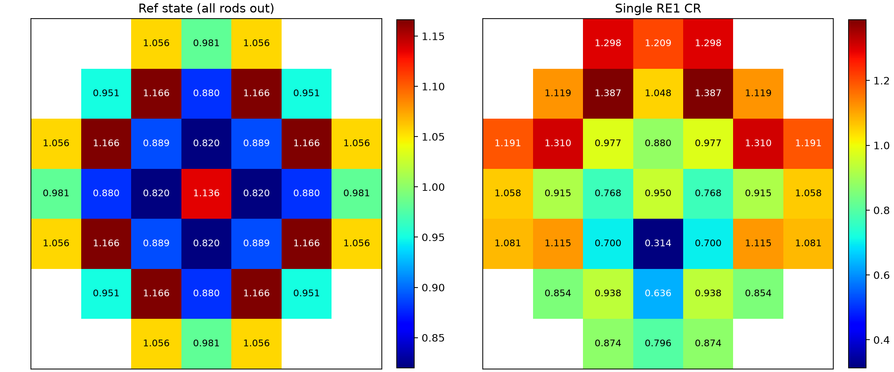
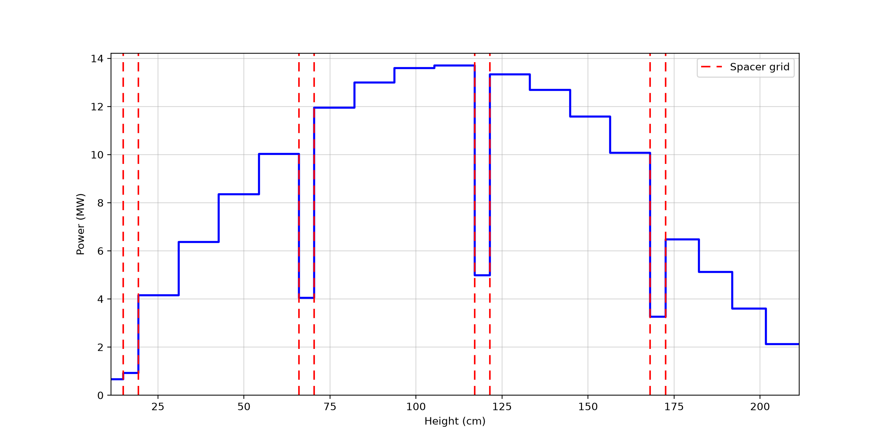
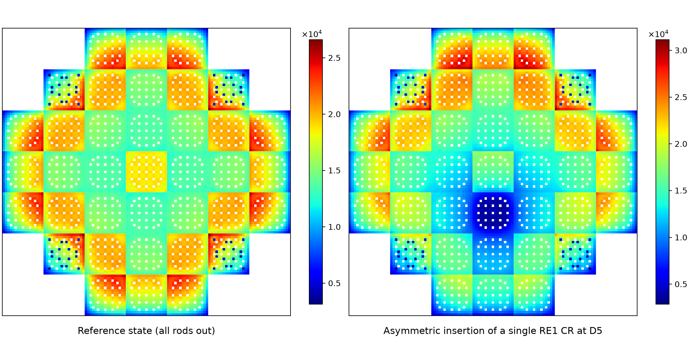
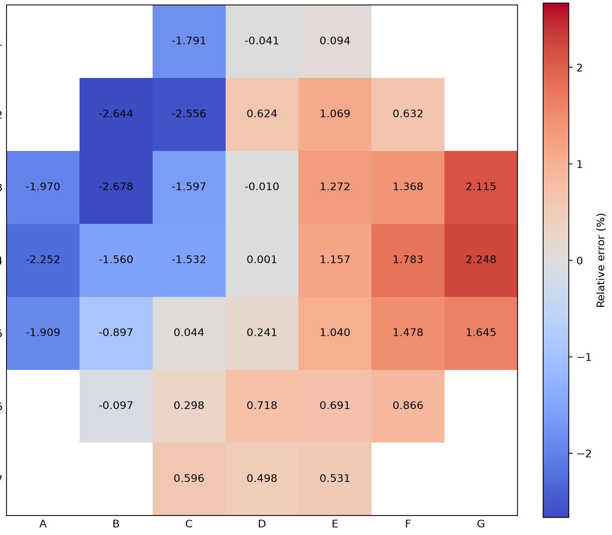
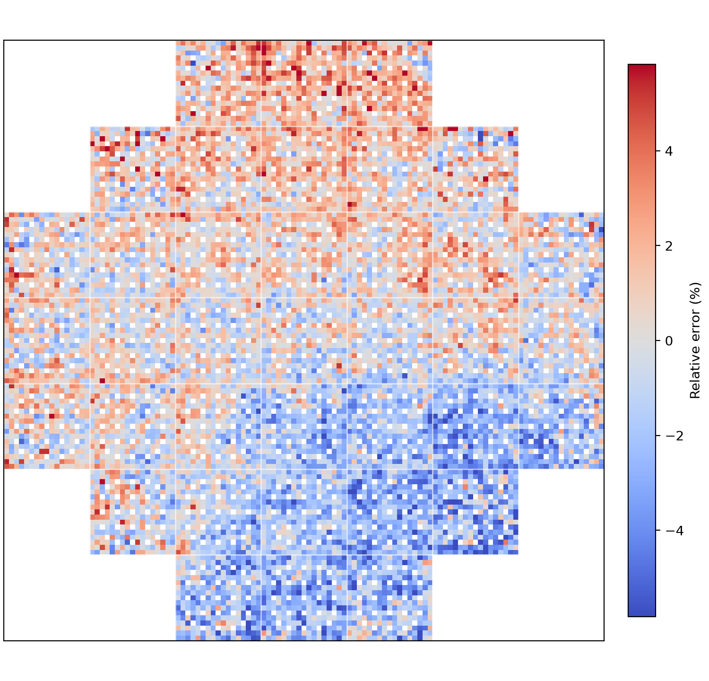
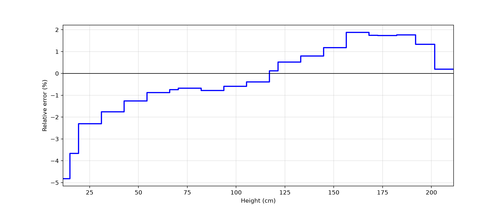
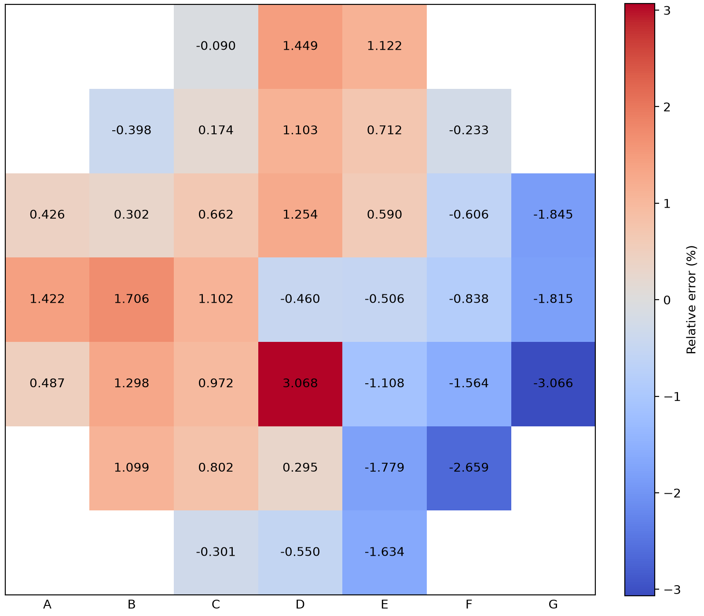
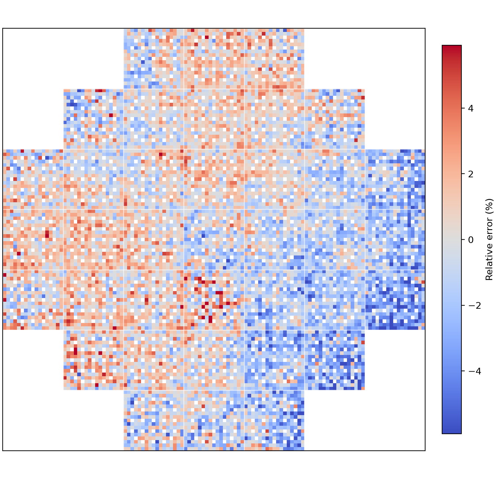

# NuScale Benchmark (OpenMC)

[](README.md)
[](README.zh-CN.md)

This repository helps reproduce/compare selected results of the NuScale benchmark: re-plot paper figures from the reference Excel, read OpenMC statepoints, and compute relative errors against the reference solution.

---

## Project Layout

- `ref/`: reference inputs (e.g. `02-Reference_Solution_v3.xlsx`, benchmark PDF)
- `data/`: OpenMC outputs per case (each folder should contain `statepoint.*.h5`)
- `figs/`: generated figures (PNG)
- `*.py`: scripts (materials/run/read/plot)

## Requirements

- Python 3
- `numpy`, `pandas`, `matplotlib`, `openpyxl`
- `openmc` (required for reading `statepoint.*.h5`; optional for running simulations)

## Usage

### 1) Re-plot paper figures from the reference Excel

- Fig.9 (7×7 radial assembly power, Ref/CR side-by-side): `python 01-plotfig9.py`
- Fig.10 (axial power): `python 01-plotfig10.py`
- Fig.11 (pin power, Ref/CR side-by-side): `python 01-plotfig11a.py`

### 2) Read keff and compute relative error vs. reference

- Script: `python 03-read_keff.py`
- It scans `data/*/statepoint.*.h5` (picks the largest statepoint index), reads `k-eff` from `ref/02-Reference_Solution_v3.xlsx` (`k-eff + CRW` sheet), prints an aligned table, and computes `rel_err(%)`.

### 3) Read tallies from statepoint and plot (rad/pin/ax)

- Script: `python 03-read_tally.py`
- Outputs: `1-rad_pow.png`, `2-pin_pow.png`, `./figs/03-ref-ax_pow.png`, etc.

### 4) Relative error plots (Fig.9 / Fig.10 / Fig.11)

- Reference (ARO): `python 04-error_ref.py`
  - Outputs: `figs/err_fig9_ref.png`, `figs/err_fig10_ref.png`, `figs/err_fig11_ref.png`
- CR (RE1 in): `python 04-error_cr.py`
  - Outputs: `figs/err_fig9_cr.png`, `figs/err_fig10_cr.png`, `figs/err_fig11_cr.png`

Relative error definition: `(calc - ref) / ref * 100%` (cells with NaN/0 reference are masked).

---

## 01 Figure Examples

**Fig.9: Radial Assembly Power Distribution (Ref/CR)**



**Fig.10: Axial Power Distribution**



**Fig.11: Pin Power Distribution (Ref/CR)**



---

## 03 Tally

```
case                k-eff    k-eff STD  ref_k-eff  ref STD  rel_err(%)
------------------  -------  ---------  ---------  -------  ----------
All rods out (ARO)  1.02799  0.00021    1.02768    0.00001  0.02998   
RE1 in              1.00699  0.00020    1.00723    0.00001  -0.02348  
RE2 in              1.00354  0.00020    1.00313    0.00001  0.04085   
SH3 in              0.98972  0.00020    0.98978    0.00001  -0.00521  
SH4 in              0.98991  0.00019    0.98971    0.00001  0.02054   
All rods in (ARI)   0.85824  0.00019    0.85791    0.00002  0.03821   
RE1 at D5 in        1.02256  0.00021    1.02207    0.00001  0.04817 
```

---

## 04 Relative Error

**Reference Relative Error (Fig.9 / Fig.10 / Fig.11)**
<div align="center">
  
  
</div>


**CR (RE1 in) Relative Error (Fig.9 / Fig.10 / Fig.11)**
<div align="center">
  
  
</div>

---
